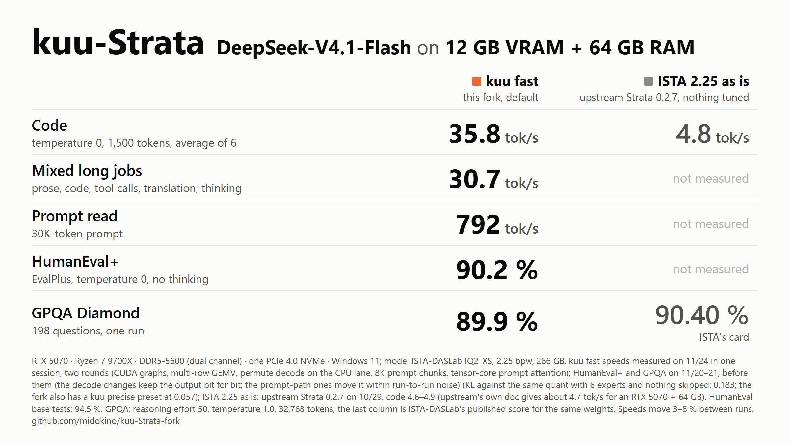
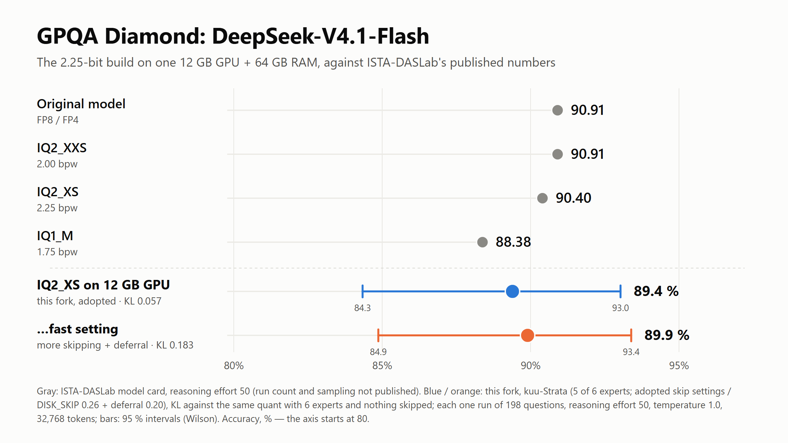

# kuu-Strata

**DeepSeek-V4.1-Flash on one 12 GB GPU — an unofficial Strata fork**



kuu-Strata is an unofficial fork of [Strata](https://github.com/Niko1221/Strata) **v0.2.12** that keeps the DeepSeek-V4.1-Flash engine
(`src/dsv41`, `strata-dsv41.exe`, upstream's port of Project Maya's `maya-ds4`) and tunes it for **one 12 GB GPU and 64 GB of RAM**. Upstream removed DeepSeek in
0.2.14; this branch does not follow upstream after 0.2.12.

It is a hobby project: one PC, measured carefully, no support. It is not affiliated with Strata, Project Maya,
DeepSeek or ISTA-DASLab.

- **No binaries, no installer.** Build the engine from source ([Building](#building)) and run `serve/server.py` from
  this checkout with a model config ([Settings on the reference PC](#settings-on-the-reference-pc)).
- **Upstream's README** (the app, the installer, the other models) is kept as [README.upstream.md](README.upstream.md).
  Its download links install the current upstream Strata, which no longer has DeepSeek.
- The speedups are software only; the numbers below are from one PC and will differ on others.

## Result on the reference PC


Ryzen 7 9700X (105 W in BIOS) · RTX 5070 12 GB · DDR5-5600 64 GB (dual channel) · one PCIe 4.0 NVMe (Crucial P310 1 TB) ·
Windows 11 · model: ISTA-DASLab DeepSeek-V4.1-Flash-1017 GSQ-RCO **IQ2_XS (2.25 bpw)**, 5 of 6 experts, DSpark drafter
on, 128K context.

| | upstream as installed (Strata 0.2.7, 10/29) | starting point (11/12: drafter on, 5 experts, nothing skipped) | kuu precise (11/20) | kuu fast (11/20) | **kuu fast, 11/24 engine (default)** |
|---|---|---|---|---|---|
| short replies (4 kinds, averaged) | about 6.7 tok/s | 12.0 tok/s | 22.4 tok/s | 28.3 tok/s | **30.9 tok/s** |
| mixed long generations ("wide": prose, code, tool calls, translation, thinking) | — | about 10 tok/s | 21.1 tok/s | 27.8 tok/s | **30.7 tok/s** |
| code, temperature 0 | 4.6–4.9 tok/s | — | 24.2 tok/s | 30.4 tok/s | **35.8 tok/s** |
| prompt read, 4.6K tokens | 56–68 tok/s | 128 / 137 tok/s | 152 / 163 tok/s | 183 / 199 tok/s | **209 / 227 tok/s** |
| prompt read, 30K tokens | — | 414 / 431 tok/s | 442 tok/s | 471 tok/s | **792 tok/s** |
| quality: KL against the same model with 6 experts and nothing skipped (3 segments, 3,000 positions) | — | 0.036 | 0.057 (±0.005 between runs) | 0.183 | — |
| GPQA Diamond (one run each, see below) | — (ISTA-DASLab's card: 90.40 %) | — | 89.4 % | 89.9 % | — |
| HumanEval / HumanEval+ (EvalPlus 0.3.1, temperature 0, no thinking) | — | — | 95.7 / 89.6 % | 94.5 / 90.2 % | — |

The 10/29 column was measured while the engine inherited a low disk priority from the program that started it (upstream fixed
that later, #4733), so its prompt reads are lower than they should be; upstream's own DeepSeek doc gives about 4.7 tok/s
for an RTX 5070 with 64 GB of RAM, which matches its code speed. Generation speed moves 3–8 % from run to run; every comparison above was made against a baseline run in the same session. The kuu precise and kuu fast columns (settings at
the end) were measured on 11/20 in one session (code: average of 3): fast is +26–32 % on generation, +20–22 % on the 4.6K
prompt and +7 % on the 30K one. kuu precise alone measured higher on other days (wide 20.6–21.6, code 24–27, 30K read
490–544), which is the run-to-run spread. The last column is the same kuu fast settings on the 11/24 engine (the CUDA, CPU and prompt-path changes in the
next section), measured on 11/24 in one session, two rounds, code an average of 6; the card and the summary image show it.
Its generation changes keep the output bit for bit and its prompt-path changes move it within run-to-run noise, so
the quality rows were not measured again.



**GPQA Diamond** (198 questions, the simple-evals / LightEval prompt, reasoning effort 50, temperature 1.0, 32,768
tokens for thinking and answer, no separate thinking budget, kuu precise (settings at the end), one run): **89.4 %** (177/198;
95 % interval 84.3–93.0 %; physics 94.2 %, chemistry 87.1 %, biology 78.9 %; 20 questions had their thinking closed near
the token limit, 10 of them still right). For reference, ISTA-DASLab's card gives 90.40 for this quant and 90.91 for the
original model (their run count and sampling settings are not published); one question's difference is well inside a
single run's noise, so the skipping below shows no measurable cost here, though one run cannot rule out a 1–2 point loss.

Two other runs, for context: with the server's thinking budget left at 4,000 tokens by a client setting, the same setup
scored 83.8 %; re-asking only that run's 32 misses without the budget turned 17 into right answers (92.4 %, an upper
bound, since re-asking only the misses also recovers the ones lost by chance).

A much more aggressive setting scored the same: `STRATA_DS4_DISK_SKIP_W=0.26` with deferral (`STRATA_DS4_DEFER=3`,
`STRATA_DS4_DEFER_W=0.20`), KL 0.183 against the reference (three times kuu precise's), got **89.9 %** (178/198)
under the same conditions, thinking at 26.7 tok/s instead of 21.8. Question by question, 169 were right in both runs, 8
only in kuu precise, 9 only in this one: no difference beyond sampling noise. So multiple-choice reasoning survives
far more skipping than KL suggests. Code came out the same way on HumanEval+ (temperature 0, no thinking): 95.7 / 89.6 %
for kuu precise and 94.5 / 90.2 % for this one (base / plus tests), one or two problems apart either way, although
only 25 of the 164 solutions were word for word the same. Exact copying and Japanese prose were not measured this way.

## What changed

All engine changes are in `src/dsv41` and are environment variables, off unless set (one exception, noted). They are
grouped by who can use them:

- **[General](#general-speedups-any-platform)**: the engine's own logic, on any OS and any GPU backend. One needs a
  CPU with AVX-512 VBMI.
- **[CUDA (NVIDIA) only](#cuda-nvidia-only-speedups)**: CUDA kernels and CUDA graphs. On HIP or Metal builds they do
  nothing or are compiled out.
- **[Windows only](#windows-only-speedups)**: fixes and settings for how Windows handles files, video memory and
  process priority.

Everything was measured on one PC (Windows 11, RTX 5070). "Identical output" means the same token ids in `--score`
runs; "KL" is against the same model with 6 experts and nothing skipped.

### General speedups (any platform)

| setting | what it does | measured |
|---|---|---|
| `STRATA_DS4_RAM_SKIP_W=0.10`, `STRATA_DS4_DISK_SKIP_W=0.20` (upstream switches; kuu fast: `0.26`) | leave out CPU-lane experts lighter than 10 % of the token's route weight, and those under 20 % that are not in RAM | the main speedup (12 → 20 tok/s); KL 0.036 → 0.064 |
| `in_ram()` counts the RAM store | the disk rule sees the store's experts as in RAM | correctness; no speed change measured |
| `STRATA_DS4_DEFER=3`, `STRATA_DS4_DEFER_W=0.20` (kuu fast) | Expert Deferral (KTransformers, SOSP '25): light experts' output added one layer late, so the CPU overlaps the GPU's attention | part of kuu fast's +26–32 % on generation |
| `STRATA_DS4_PROMPT_SKIP=2` (upstream switch, kuu fast) | DeepSeek's own serving's long-prompt skip: past layer 20 only the last 128 rows | part of kuu fast's prompt-read gain |
| `DS4_MTP_VRAM_GB` (cap, default unlimited) + `--dspark on` | caps the DSpark drafter's experts in VRAM so the trunk keeps room (0.5 GB used), so the drafter can stay on | code +29 %, thinking +22 %, prompt reads unchanged |
| RAM store size classes per layer | the store's slots sized per layer instead of the largest layer's | more experts in the same RAM |
| `STRATA_DS4_DSPARK_LAZY=1` (from Project Maya's `DS4_DSPARK_LAZY`) | the drafter head stops at the first draft the confidence cut drops | +2–5 %, identical output |
| `STRATA_DS4_LM_AHEAD=1` | during a long prompt, read the next layer's likely experts ahead | 30K read +7 % |
| `STRATA_DS4_EG_RING=8` (after reading Xolotl's Engram prefetch) | the prompt path's Engram rows read ahead by a helper thread | 30K read +6 %, identical output |
| `--prefill-chunk 8192` + `STRATA_DS4_LEND_ALL=1`, `STRATA_DS4_LEND_ROOM=1.2` (11/24) | prompts in 8K chunks instead of 4K, so each layer's experts cross PCIe half as often. Upstream lends a chunk's buffers the tail of the VRAM expert slots only for MXFP4 packs; `LEND_ALL` does it for the i-quant packs too (without it, 8K chunks cost 160 of 288 VRAM experts and decode drops 15–20 %) | 30K read 50.5 → 42.1 s (+20 %), 4.6K +11 %; decode, short replies and "wide" unchanged |
| `STRATA_IQ_XXS_PERM=1` (11/23) — **CPU: AVX-512 with VBMI and VPOPCNTDQ** (Ryzen 7000 / 9000, Intel Ice Lake and later server or workstation parts; other CPUs keep the existing rows automatically) | the CPU lane's IQ2_XXS blocks (60 % of the expert bytes) decoded with permute instructions (`vpermb`, `vpermt2w`, `vpmultishiftqb`) instead of 32 table loads a block | −5.5 % time a token, identical output; the 1-token kernel 46 → 53 GB/s on 8 threads |
| `STRATA_DS4_SHARED_LEAST=128` etc. (server) | keep a short shared system prompt's start in the prefix cache | agent tool-approval turns 12 s → 6 s |
| the IQ2_XXS DSpark drafter (`tools/dsv41/drafter_pack.py`, [below](#the-dspark-drafter-in-iq2_xxs)) | the drafter requantized from 8 GB Q8_0 | 1–2 GB of RAM back, acceptance unchanged (86–88 %) |

### CUDA (NVIDIA) only speedups

The build in this fork is CUDA only. These are CUDA kernels or CUDA graphs; a HIP or Metal build leaves them out or never
takes them.

| setting | what it does | measured |
|---|---|---|
| `STRATA_DS4_GRAPH=3` + `STRATA_DS4_SEQ_ALIGN=1` (11/23) | **CUDA graphs** for the decode layers. Every launch and copy of a layer is recorded once (a "tape") and replayed from a kept graph from then on; the values that change from step to step (positions, row lists, mailbox slots) live in fixed device slots, so one graph serves every step. A layer that cannot be recorded plays its tape as ordinary launches | −3.8 % time a token, identical output |
| `STRATA_DS4_MV_R=2` (11/23) | the dense Q5_K / Q6_K matrices (attention, shared experts) with 2 rows a warp, each column's activations loaded once for both. A verify window's 16-column GEMV was running at a third of the 1-column one's bandwidth | −3.2 % time a token, identical output |
| `DS4_FAST_ATTN=1` (11/24; upstream's switch, HIP only until now) | the chunked prompt's sparse attention on the tensor cores: upstream's RDNA4 WMMA scheme ported to `mma.sync` m16n8k16 (FP16 in, FP32 sums, sm_80 and later; 16 heads of one query a block, the softmax rescaled per head in registers). The sums' order differs from the scalar kernel's, so the output is not bit-identical | sparse attention 7.4 → 2.2 s, 30K read 41.6 → 36.6 s (−12 %); first-token KL against the scalar kernel inside the run-to-run spread of the scalar kernel itself (0.033–0.038 against 0.039) |
| `STRATA_DS4_ROUTER_BF16=1` (the idea of Project Maya's `MAYA_DS4_ROUTER_BF16`, own kernel) | keep the router in BF16 (as stored) instead of an F32 copy; the same sums | +19 experts in VRAM, identical output |
| the BF16 router in 4 × 8 tiles (11/24; **on by default**, `STRATA_DS4_ROUTER_TILE=0` turns it off) | over a prompt's chunk, one warp computes 4 router rows × 8 tokens, each value loaded once for the tile's 32 dots; every dot keeps the row-at-a-time kernel's own order (`DS4_ROUTER_TILE_CHECK=N` compares the two: 60 of 60 identical) | router 1.22 → 0.63 s on a 30K prompt (about −0.5 s), identical output |

### Windows only speedups

| setting | what it does | measured |
|---|---|---|
| `STRATA_DS4_DROP_SHARDS=1` | after the load, close the expert shards' buffered file handles and views, leaving unbuffered handles only. On Windows a file kept open buffered (or mapped) made the unbuffered reads of the same file slow (the code runs everywhere; the problem was found and measured on Windows) | prompt read +7–17 % |
| `--reserve-mib 200` (a setting) | keep 200 MiB of VRAM free. Below about 150 MiB, Windows (WDDM) silently moved VRAM into shared system memory: no error, just slower | avoids a silent slowdown |
| start the server at task priority 4, not 7 (Task Scheduler) | a scheduled task at priority 7 gives its process memory priority 2, and Windows trimmed the 36 GB RAM store out within about 10 minutes of idling | keeps the RAM store resident |
| the engine's I/O priority (upstream #4733, fixed in 0.2.10) | before 0.2.10 the engine inherited the I/O priority of the program that started it; started from a low-priority shell, every disk read ran at low priority | prompt reads about 1.5× (why the 10/29 column's prompt reads are low) |

Also on Windows: the weekly "Optimize Drives" task (re-trim of an SSD) runs while the PC is idle, and a benchmark that
overlaps it reads the experts from a busy SSD (on the reference PC: Mondays around 10–11 am).

### Measured and **not** adopted

(kept, off by default, so the numbers can be reproduced)

| setting | idea | result |
|---|---|---|
| `STRATA_DS4_DEFER_BUDGET=1`, `_DEFER_US_MAX` | defer only what fits the CPU's idle time, the budget learned online | KL 0.097 → 0.089 against plain deferral at the same cap, the same speed/KL line |
| `STRATA_DS4_WIN_CUT` | drop a verify window's tail rows when their new experts cost more than their chance of being accepted | +0.4 % |
| `STRATA_DS4_ACE=1`, `_NORM_DUMP`, `_NORM_FILE` | ACE-style skip (arXiv 2609.05228): weight × expert norm | no point beyond the plain rule's line |
| `STRATA_DS4_DRAFT_RAM_W` / `_DRAFT_DISK_W` | higher skip thresholds on draft rows only | big quality loss |
| others in `4d3b2d3a` | routing / budget variants F1, F2, E2, A2, A3 | none beat the plain rule |
| `STRATA_DS4_GRAPH=2` | per-layer stream capture | replaced by `GRAPH=3` |
| `STRATA_IQ_XXS_PERM=2` | the permute decode for IQ2_XS (a 16-register table) | +7–10 % on IQ2_XS calls in the bench, no change in total time |
| `DS4_GG_IQ512=1` | IQ2_S on AVX-512 | no change |
| `STRATA_DS4_CPU_LANE=smt` | the CPU lane on both threads of every core | −3–4 % per CPU-lane call, the same total time |
| GEMV through shared memory, hoisted sums, fewer registers | — | none beat `MV_R=2`; at 6 columns it is bound by instruction issue |
| `--prefill-chunk 12288` / `16384` | fewer chunks still | the lending room ends at 8K: 12K and 16K left 32 and 0 experts in VRAM, much slower |
| `DS4_RING_MB` 1200 / 2400 | a larger streaming ring for the prompt path | the ring's VRAM came out of the VRAM experts: slower |
| `DS4_FAT_ROWS=64` | busy experts as FP16 cuBLAS GEMMs | expert kernels 9.1 → 7.8 s, the prompt the same (it waits for PCIe, not for compute) |
| the layer-major state's copy out and copy in overlapped (two directions of PCIe at once) | — | no change |

Where the time goes now: decode is two thirds the CPU lane's expert compute, at about 43 GB/s of the 9700X's ~60 GB/s;
a 30K prompt is about 26 s of experts crossing PCIe (every chunk sends each layer's ~3 GB again) and about 10 s of the
last 128 rows' experts read from the SSD at its limit. The next step is fewer bytes (the 2.00 bpw quant), not faster
kernels.

## Getting DSpark drafts on a 12 GB card

Upstream's `--dspark auto` measures a few answers at start and, on a 12 GB card, decides to leave the drafter off (the
DeepSeek doc says the same for an RTX 3060). Forcing it on made code about 30 % and thinking 10–20 % faster, but prompt
reading collapsed: a 4.6K-token prompt took 546 s. The drafter's 384 experts took VRAM first and left the trunk layers
no slots, so the chunked prompt path could not borrow room. Requantizing the drafter to 2 bits did not help (a drafter
expert is about as big as a trunk expert). The fix is an engine change: `DS4_MTP_VRAM_GB` caps the drafter's share of
VRAM (commit `19cbf656`). With 0.5 GB, the drafter stays on, code is +29 % and thinking +22 %, and prompt reads are what
they were. The IQ2_XXS drafter (next sections) then gives 1–2 GB of RAM back, which keeps long prompts fast when RAM is
tight. DSpark acceptance is 86–88 %.

## Where the changes are

The rest of the tree is upstream Strata v0.2.12 as released (`146df3c4`), apart from the READMEs and upstream's GitHub
automation (workflows, issue templates, funding links), which were removed, and four upstream tests adjusted to match. The engine changes are in 18 files:

- `src/dsv41/`: `ds4_model.cu` (most of it), `ds4_kernels.cu` / `.cuh`, `ds4_launch.h` (the graph tape), `ds4_iq.cu` / `.cuh`
  (the multi-row GEMV), `ds4_store.hpp`, `ds4_os.hpp`, `ds4_gg_cpu.cpp`, `ds4_gguf.cu`, `ds4_pool.hpp`, `ds4_model.hpp`,
  `ds4_main.cpp`
- `src/kernels/cpu/iq_avx512.cpp` (the IQ2_XXS permute decode)
- `serve/server.py` (the shared system-prompt cache settings), `tools/dsv41/drafter_pack.py` (IQ1 requant options)
- tests: `tests/dsv41/ds4_gguf_test.cu` (`--bench-iqmv`), `tests/dsv41/gg_dot_bench.cpp` (`--calls K`, the CPU lane's call shape)

To see them against upstream:

```sh
git remote add upstream https://github.com/Niko1221/Strata
git fetch upstream tag v0.2.12 --no-tags
git diff v0.2.12 main -- src serve tools
```

## Building

Windows, CUDA 13, Visual Studio 2022 Build Tools, a llama.cpp checkout for ggml:

```bat
set STRATA_GGML_DIR=C:/path/to/llama.cpp
set DSV41_ARCH=120-real
packaging\build_dsv41_windows.bat C:/path/to/build-dir
```

Copy `strata-dsv41.exe` into a folder next to the release engine's DLLs (`cublas64_13.dll`, `cublasLt64_13.dll`) and point
the model config's `exe` / `lib_dirs` at it.

## The DSpark drafter in IQ2_XXS

The 8 GB Q8_0 drafter leaves too little RAM on a 64 GB machine. Requantizing DeepSeek's own drafter (the three shards
`model-00044..46-of-00048` of the official checkpoint) keeps the acceptance rate (86–88 %) and frees 1–2 GB:

```bat
python tools\dsv41\drafter_pack.py --dir <folder with the three shards>
python tools\dsv41\drafter_pack.py --dir <same folder> --requant iq2 --experts IQ2_XXS --dense Q8_0 --lib <llama.cpp>\ggml-base.dll --jobs 12
```

Then build a pack with it (`pack_gguf.py --drafter`) and copy the six `dspark_*` lines of `ds4.txt` from a working pack:
`pack_gguf.py --drafter` writes them as 0 and the drafter is then silently not loaded.

## Settings on the reference PC

Two presets, both in the model config's `args` / `env` (the card at the top is kuu fast).

### kuu fast (the default)

```json
"args": ["--max-context", "131072", "--eos", "1", "--vision", "off", "--dspark", "on", "--dspark-conf", "0.65", "--reserve-mib", "200",
         "--prefill-chunk", "8192"],
"env": {
  "DS4_MTP_VRAM_GB": "0.5",
  "STRATA_DS4_DISK_SKIP_W": "0.26",
  "STRATA_DS4_RAM_SKIP_W": "0.10",
  "STRATA_DS4_DEFER": "3",
  "STRATA_DS4_DEFER_W": "0.20",
  "STRATA_DS4_PROMPT_SKIP": "2",
  "STRATA_DS4_DROP_SHARDS": "1",
  "STRATA_DS4_DSPARK_LAZY": "1",
  "STRATA_DS4_LM_AHEAD": "1",
  "STRATA_DS4_ROUTER_BF16": "1",
  "STRATA_DS4_EG_RING": "8",
  "STRATA_DS4_GRAPH": "3",
  "STRATA_DS4_SEQ_ALIGN": "1",
  "STRATA_DS4_MV_R": "2",
  "STRATA_IQ_XXS_PERM": "1",
  "STRATA_DS4_LEND_ALL": "1",
  "STRATA_DS4_LEND_ROOM": "1.2",
  "DS4_FAST_ATTN": "1"
}
```

The last seven lines (and `--prefill-chunk 8192`) are the 11/23–24 additions; they go into kuu precise as well. On a
non-NVIDIA build leave out `GRAPH`, `SEQ_ALIGN`, `MV_R` and `DS4_FAST_ATTN`; on a CPU without AVX-512 VBMI
`IQ_XXS_PERM` turns itself off.

More skipping of light experts that are not in RAM, deferral of the light experts that remain, and the shorter prompt
skip. KL against the reference is 0.183 (kuu precise: 0.057), but kuu fast matched kuu precise on GPQA Diamond
(89.9 / 89.4 %) and HumanEval+ (base 94.5 / 95.7 %, plus 90.2 / 89.6 %), at about +30 % on generation and +7 % on
30K-token prompt reads. Exact copying and Japanese prose have not been checked, and KL says the wording changes more
there.

`--reserve-mib 200` and the 105 W BIOS setting depend on the machine: below 150 MiB the reference PC's VRAM spilled into
shared memory, which Windows does silently (slower, no error).

### kuu precise (closest to the unskipped model)

kuu fast with less skipping and no deferral. In `env`, change one value and drop three:

```json
  "STRATA_DS4_DISK_SKIP_W": "0.20",
```

and remove `STRATA_DS4_DEFER`, `STRATA_DS4_DEFER_W` and `STRATA_DS4_PROMPT_SKIP`. `STRATA_DS4_DISK_SKIP_W=0.24` alone is
a step in between (+18 % on mixed long jobs, KL 0.114).

## Credits

- [Strata](https://github.com/Niko1221/Strata) by Niko1221 and the Strata contributors (MIT) — the engine this is built on.
- [Project Maya](https://github.com/mw00/project-maya) by Peasant Smith and the Project Maya contributors (MIT) — the DeepSeek
  engine itself (`src/dsv41` is upstream Strata's port of Maya's `maya-ds4`; notice in `third_party/project-maya`), and
  later the lazy drafter head, the BF16 router and several ideas measured here; see `NOTICE`.
- [Xolotl](https://github.com/Indras-Mirror/Xolotl) — the Engram prefetch idea; [Strata-xeno](https://github.com/xenodeve/Strata-xeno)
  — an earlier Expert Deferral attempt (#254).
- DeepSeek-V4.1-Flash by DeepSeek (MIT); the GSQ-RCO quants by ISTA-DASLab; the DSpark drafter GGUF by Unsloth.
- Papers: H. Chen et al., *KTransformers: Unleashing the Full Potential of CPU/GPU Hybrid Inference for MoE Models*,
  SOSP '25 (Expert Deferral); *ACE* (arXiv 2609.05228); EcoSpec (arXiv 2607.12696) and DraftExpert (arXiv 2607.24434)
  for the window cut.
- Written together with Claude (Anthropic); the commits say so.
