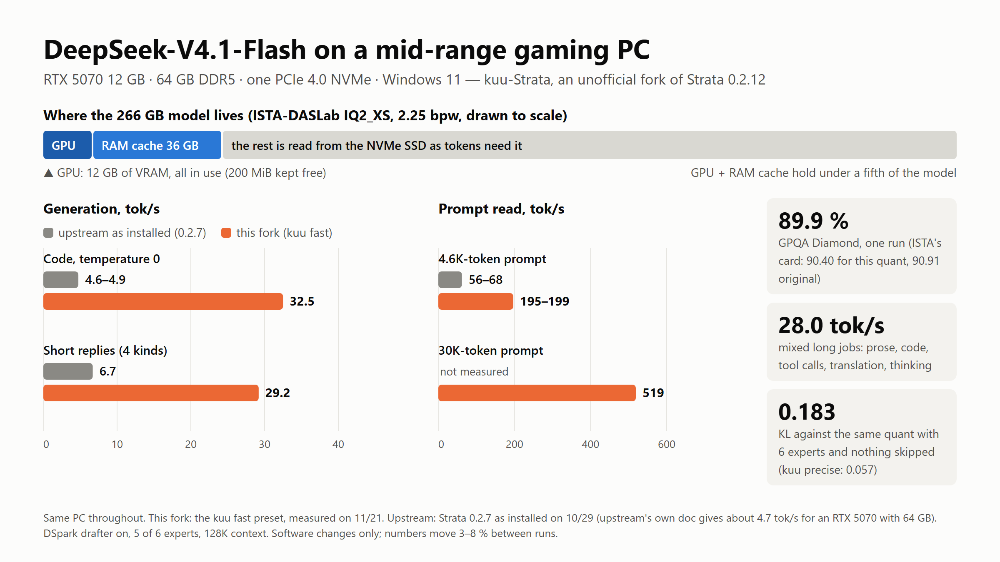

# kuu-Strata

**DeepSeek-V4.1-Flash on one 12 GB GPU — an unofficial Strata fork**


kuu-Strata is an unofficial fork of [Strata](https://github.com/Niko1221/Strata) **v0.2.12** that keeps the DeepSeek-V4.1-Flash engine
(`src/dsv41`, `strata-dsv41.exe`) and tunes it for **one 12 GB GPU and 64 GB of RAM**. Upstream removed DeepSeek in
0.2.14; this branch does not follow upstream after 0.2.12.

It is a hobby project: one PC, measured carefully, no support. It is not affiliated with Strata, Project Maya,
DeepSeek or ISTA-DASLab.

- **No binaries, no installer.** Build the engine from source ([Building](#building)) and run `serve/server.py` from
  this checkout with a model config ([Settings on the reference PC](#settings-on-the-reference-pc)).
- **Upstream's README** (the app, the installer, the other models) is kept as [README.upstream.md](README.upstream.md).
  Its download links install the current upstream Strata, which no longer has DeepSeek.
- The speedups are software only; the numbers below are from one PC and will differ on others.

## Result on the reference PC



Ryzen 7 9700X (105 W in BIOS) · RTX 5070 12 GB · DDR5-5600 64 GB (dual channel) · one PCIe 4.0 NVMe (Crucial P310 1 TB) ·
Windows 11 · model: ISTA-DASLab DeepSeek-V4.1-Flash-1017 GSQ-RCO **IQ2_XS (2.25 bpw)**, 5 of 6 experts, DSpark drafter
on, 128K context.

| | upstream as installed (Strata 0.2.7, 10/29) | starting point (11/12: drafter on, 5 experts, nothing skipped) | kuu precise (this fork, default) | kuu fast |
|---|---|---|---|---|
| short replies (4 kinds, averaged) | about 6.7 tok/s | 12.0 tok/s | 22–23 tok/s | 28.3 tok/s |
| mixed long generations ("wide": prose, code, tool calls, translation, thinking) | — | about 10 tok/s | 20.6–21.6 tok/s | 27.8 tok/s |
| code, temperature 0 | 4.6–4.9 tok/s | — | 24–27 tok/s | 29–33 tok/s |
| prompt read, 4.6K tokens | 56–68 tok/s | 128 / 137 tok/s | 152 / 164 tok/s | 183 / 199 tok/s |
| prompt read, 30K tokens | — | 414 / 431 tok/s | 490–544 tok/s | 471 tok/s |
| quality: KL against the same model with 6 experts and nothing skipped (3 segments, 3,000 positions) | — | 0.036 | 0.057 (±0.005 between runs) | 0.183 |
| GPQA Diamond (one run each, see below) | — (ISTA-DASLab's card: 90.40 %) | — | 89.4 % | 89.9 % |
| HumanEval / HumanEval+ (EvalPlus 0.3.1, temperature 0, no thinking) | — | — | 95.7 / 89.6 % | 94.5 / 90.2 % |

The 10/29 column was measured while the engine inherited a low disk priority from the program that started it (upstream fixed
that later, #4733), so its prompt reads are lower than they should be; upstream's own DeepSeek doc gives about 4.7 tok/s
for an RTX 5070 with 64 GB of RAM, which matches its code speed. Generation speed moves 3–8 % from run to run; every comparison above was made against a baseline run in the same session. The kuu fast column (settings at the end) was
measured on 11/20 in one session with kuu precise, which gave 22.4 (short), 21.1 (wide), 24.2 (code), 152 / 163 and 442 there;
against that run fast is +26–32 % on generation, +20–22 % on the 4.6K prompt and +7 % on the 30K one.


**GPQA Diamond** (198 questions, the simple-evals / LightEval prompt, reasoning effort 50, temperature 1.0, 32,768
tokens for thinking and answer, no separate thinking budget, the adopted settings below, one run): **89.4 %** (177/198;
95 % interval 84.3–93.0 %; physics 94.2 %, chemistry 87.1 %, biology 78.9 %; 20 questions had their thinking closed near
the token limit, 10 of them still right). For reference, ISTA-DASLab's card gives 90.40 for this quant and 90.91 for the
original model (their run count and sampling settings are not published); one question's difference is well inside a
single run's noise, so the skipping below shows no measurable cost here, though one run cannot rule out a 1–2 point loss.

Two other runs, for context: with the server's thinking budget left at 4,000 tokens by a client setting, the same setup
scored 83.8 %; re-asking only that run's 32 misses without the budget turned 17 into right answers (92.4 %, an upper
bound, since re-asking only the misses also recovers the ones lost by chance).

A much more aggressive setting scored the same: `STRATA_DS4_DISK_SKIP_W=0.26` with deferral (`STRATA_DS4_DEFER=3`,
`STRATA_DS4_DEFER_W=0.20`), KL 0.183 against the reference (three times the adopted setting's), got **89.9 %** (178/198)
under the same conditions, thinking at 26.7 tok/s instead of 21.8. Question by question, 169 were right in both runs, 8
only in the adopted one, 9 only in this one: no difference beyond sampling noise. So multiple-choice reasoning survives
far more skipping than KL suggests. Code came out the same way on HumanEval+ (temperature 0, no thinking): 95.7 / 89.6 %
for the adopted setting and 94.5 / 90.2 % for this one (base / plus tests), one or two problems apart either way, although
only 25 of the 164 solutions were word for word the same. Exact copying and Japanese prose were not measured this way.

## What changed (all in `src/dsv41`, environment variables, off unless set)

Adopted on the reference PC (the settings it runs with are at the end):

| setting | what it does | measured |
|---|---|---|
| `STRATA_DS4_RAM_SKIP_W=0.10`, `STRATA_DS4_DISK_SKIP_W=0.20` (upstream switches) | leave out CPU-lane experts lighter than 10 % of the token's route weight, and those under 20 % that are not in RAM | the main speedup (12 → 20 tok/s); KL 0.036 → 0.064 |
| `in_ram()` counts the RAM store | the disk rule sees the store's experts as in RAM | correctness; no speed change measured |
| `STRATA_DS4_DROP_SHARDS=1` | close the expert shards' buffered file handles and views after load | prompt read +7–17 % (cached handles made unbuffered reads slow) |
| `DS4_MTP_VRAM_GB` (cap, default unlimited) + `--dspark on` | caps the DSpark drafter's experts in VRAM so the trunk keeps room (0.5 GB used), so the drafter can stay on (see below) | code +29 %, thinking +22 %, prompt reads unchanged |
| RAM store size classes per layer | the store's slots sized per layer instead of the largest layer's | more experts in the same RAM |
| `STRATA_DS4_DSPARK_LAZY=1` (from Project Maya's `DS4_DSPARK_LAZY`) | the drafter head stops at the first draft the confidence cut drops | +2–5 %, identical output |
| `STRATA_DS4_LM_AHEAD=1` | during a long prompt, read the next layer's likely experts ahead | 30K read +7 % |
| `STRATA_DS4_ROUTER_BF16=1` (the idea of Project Maya's `MAYA_DS4_ROUTER_BF16`, own kernel) | keep the router in BF16 (as stored) instead of an F32 copy; same sums bit for bit | +19 experts in VRAM, identical output |
| `STRATA_DS4_EG_RING=8` (after reading Xolotl's Engram prefetch) | the prompt path's Engram rows read ahead by a helper thread | 30K read +6 %, identical output |
| `STRATA_DS4_SHARED_LEAST=128` etc. (server) | keep a short shared system prompt's start in the prefix cache | agent tool-approval turns 12 s → 6 s |

Measured and **not** adopted (kept, off by default, so the numbers can be reproduced):

| setting | idea | result |
|---|---|---|
| `STRATA_DS4_DEFER=1..4`, `_DEFER_W`, `_DEFER_K`, `_DEFER_COLD` | Expert Deferral (KTransformers, SOSP '25; Strata-xeno #254 tried the same first): light experts' output added one layer late so the CPU overlaps the GPU's attention; exact through DeepSeek's hyper-connection mixing | without drafts +11 % at KL +0.02; with DSpark drafts the gain halves and it lands on the same speed/KL line as a higher `DISK_SKIP_W` |
| `STRATA_DS4_DEFER_BUDGET=1`, `_DEFER_US_MAX` | defer only what fits the CPU's idle time, the budget learned online (the paper's "saturate the CPU" rule) | KL 0.097 → 0.089 against plain deferral at the same cap, still on the same line |
| `STRATA_DS4_WIN_CUT` | drop a verify window's tail rows when their new experts cost more than their chance of being accepted | +0.4 % (the drafts were right 80+ % of the time where it cut) |
| `STRATA_DS4_ACE=1`, `_NORM_DUMP`, `_NORM_FILE` | ACE-style skip (arXiv 2609.05228): weight × expert norm, both views, top-1 kept | no point beyond the plain rule's line |
| `STRATA_DS4_DRAFT_RAM_W` / `_DRAFT_DISK_W` | higher skip thresholds on draft rows only | big quality loss |
| others in `4d3b2d3a` | routing / budget variants F1, F2, E2, A2, A3 | none beat the plain rule |

A faster setting that measured well: `STRATA_DS4_DISK_SKIP_W=0.24` gives +18 % on "wide" and about 28–31 tok/s on
code at temperature 0, at KL 0.114 (English suffers most). Going further, `DISK_SKIP_W=0.26` with deferral 0.20 reaches
about 35 tok/s on code at KL 0.183 and still scored 89.9 % on GPQA Diamond (above). Neither is the default: KL says they
change the text more; GPQA and HumanEval+ came out the same, exact copying and Japanese prose are unchecked.

## Getting DSpark drafts on a 12 GB card

Upstream's `--dspark auto` measures a few answers at start and, on a 12 GB card, decides to leave the drafter off (the
DeepSeek doc says the same for an RTX 3060). Forcing it on made code about 30 % and thinking 10–20 % faster, but prompt
reading collapsed: a 4.6K-token prompt took 546 s. The drafter's 384 experts took VRAM first and left the trunk layers
no slots, so the chunked prompt path could not borrow room. Requantizing the drafter to 2 bits did not help (a drafter
expert is about as big as a trunk expert). The fix is an engine change: `DS4_MTP_VRAM_GB` caps the drafter's share of
VRAM (commit `19cbf656`). With 0.5 GB, the drafter stays on, code is +29 % and thinking +22 %, and prompt reads are what
they were. The IQ2_XXS drafter (next sections) then gives 1–2 GB of RAM back, which keeps long prompts fast when RAM is
tight. DSpark acceptance is 86–88 %.

## Where the changes are

The rest of the tree is upstream Strata v0.2.12 as released (`146df3c4`), apart from the READMEs and upstream's GitHub
automation (workflows, issue templates, funding links), which were removed, and four upstream tests adjusted to match. The engine changes are in 12 files:

- `src/dsv41/`: `ds4_model.cu` (most of it), `ds4_store.hpp`, `ds4_kernels.cu` / `.cuh`, `ds4_os.hpp`, `ds4_gg_cpu.cpp`,
  `ds4_gguf.cu`, `ds4_pool.hpp`, `ds4_model.hpp`, `ds4_main.cpp`
- `serve/server.py` (the shared system-prompt cache settings), `tools/dsv41/drafter_pack.py` (IQ1 requant options)

To see them against upstream:

```sh
git remote add upstream https://github.com/Niko1221/Strata
git fetch upstream tag v0.2.12 --no-tags
git diff v0.2.12 main -- src serve tools
```

## Building

Windows, CUDA 13, Visual Studio 2022 Build Tools, a llama.cpp checkout for ggml:

```bat
set STRATA_GGML_DIR=C:/path/to/llama.cpp
set DSV41_ARCH=120-real
packaging\build_dsv41_windows.bat C:/path/to/build-dir
```

Copy `strata-dsv41.exe` into a folder next to the release engine's DLLs (`cublas64_13.dll`, `cublasLt64_13.dll`) and point
the model config's `exe` / `lib_dirs` at it.

## The DSpark drafter in IQ2_XXS

The 8 GB Q8_0 drafter leaves too little RAM on a 64 GB machine. Requantizing DeepSeek's own drafter (the three shards
`model-00044..46-of-00048` of the official checkpoint) keeps the acceptance rate (86–88 %) and frees 1–2 GB:

```bat
python tools\dsv41\drafter_pack.py --dir <folder with the three shards>
python tools\dsv41\drafter_pack.py --dir <same folder> --requant iq2 --experts IQ2_XXS --dense Q8_0 --lib <llama.cpp>\ggml-base.dll --jobs 12
```

Then build a pack with it (`pack_gguf.py --drafter`) and copy the six `dspark_*` lines of `ds4.txt` from a working pack:
`pack_gguf.py --drafter` writes them as 0 and the drafter is then silently not loaded.

## Settings on the reference PC

Two presets, both in the model config's `args` / `env` (the numbers in the card at the top are these two).

### kuu precise (the default)

```json
"args": ["--max-context", "131072", "--eos", "1", "--vision", "off", "--dspark", "on", "--dspark-conf", "0.65", "--reserve-mib", "200"],
"env": {
  "DS4_MTP_VRAM_GB": "0.5",
  "STRATA_DS4_DISK_SKIP_W": "0.20",
  "STRATA_DS4_RAM_SKIP_W": "0.10",
  "STRATA_DS4_DROP_SHARDS": "1",
  "STRATA_DS4_DSPARK_LAZY": "1",
  "STRATA_DS4_LM_AHEAD": "1",
  "STRATA_DS4_ROUTER_BF16": "1",
  "STRATA_DS4_EG_RING": "8"
}
```

`--reserve-mib 200` and the 105 W BIOS setting depend on the machine: below 150 MiB the reference PC's VRAM spilled into
shared memory, which Windows does silently (slower, no error).

### kuu fast

kuu precise with three changes: more skipping of light experts that are not in RAM, deferral of the light experts
that remain, and the shorter prompt skip. About +30 % on generation and +7 % on 30K-token prompt reads; KL against
the reference triples (0.057 → 0.183), but GPQA Diamond scored the same (89.9 % against 89.4 %). In `env`, change one
value and add three:

```json
  "STRATA_DS4_DISK_SKIP_W": "0.26",
  "STRATA_DS4_DEFER": "3",
  "STRATA_DS4_DEFER_W": "0.20",
  "STRATA_DS4_PROMPT_SKIP": "2"
```

kuu fast matched kuu precise on GPQA Diamond (89.9 / 89.4 %) and HumanEval+ (base 94.5 / 95.7 %, plus 90.2 / 89.6 %);
exact copying and Japanese prose have not been checked, and KL says the wording changes more there. `STRATA_DS4_DISK_SKIP_W=0.24` alone is a milder step (+18 % on mixed
long jobs, KL 0.114).

## Credits

- [Strata](https://github.com/Niko1221/Strata) by Niko1221 and the Strata contributors (MIT) — the engine this is built on.
- [Project Maya](https://github.com/mw00/project-maya) by Peasant Smith and the Project Maya contributors (MIT) — the lazy
  drafter head, the BF16 router and several ideas measured here; see `NOTICE`.
- [Xolotl](https://github.com/Indras-Mirror/Xolotl) — the Engram prefetch idea; [Strata-xeno](https://github.com/xenodeve/Strata-xeno)
  — an earlier Expert Deferral attempt (#254).
- DeepSeek-V4.1-Flash by DeepSeek (MIT); the GSQ-RCO quants by ISTA-DASLab; the DSpark drafter GGUF by Unsloth.
- Papers: H. Chen et al., *KTransformers: Unleashing the Full Potential of CPU/GPU Hybrid Inference for MoE Models*,
  SOSP '25 (Expert Deferral); *ACE* (arXiv 2609.05228); EcoSpec (arXiv 2607.12696) and DraftExpert (arXiv 2607.24434)
  for the window cut.
- Written together with Claude (Anthropic); the commits say so.
